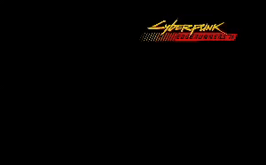

<p align="center">
  
</p>

# Cyberpunk Edgerunners II — Screen Saver / 屏幕保护程序

A classic DVD-style bouncing-logo screen saver built from the Cyberpunk
Edgerunners II logo. The logo drifts in a straight diagonal line and bounces off
the screen edges. Available for both macOS and Windows.

从 Cyberpunk Edgerunners II logo 制作的经典 DVD 样式屏幕保护程序：logo 沿对角线匀速移动，
碰到屏幕边缘就反弹。提供 macOS 和 Windows 两个版本。

---

## Folder layout / 目录结构

```
edgerunners_2_screen_saver/
├── assets/
│   └── demo.gif                      # README demo / 效果演示
├── macos/
│   └── EdgeRunners2.saver            # macOS screen saver bundle / macOS 屏保
├── windows/
│   └── EdgeRunners2_windows.zip      # zip containing EdgeRunners2.scr / 内含 .scr 文件的压缩包
└── source/                           # all source code / 全部源码
    ├── original.png                  # the source image / 原始图片
    ├── logo.png                      # extracted transparent logo / 抠出的透明 logo
    ├── extract/                      # logo extraction tool (Go) / 抠图工具
    ├── macos/                        # macOS saver source (Objective-C) / macOS 源码
    └── windows/                      # Windows saver source (Go) / Windows 源码
```

> **Why is the Windows file a `.zip`? / 为什么 Windows 是压缩包？**
> This Mac runs the SentinelOne security agent, which automatically quarantines
> any unsigned `.scr` executable within seconds of it being created. Shipping the
> `.scr` inside a zip keeps it intact. Just unzip it on your Windows PC.
>
> 这台 Mac 装有 SentinelOne 安全软件，会在生成后几秒内自动隔离（删除）未签名的 `.scr`
> 可执行文件。把 `.scr` 放进压缩包就能保留它，在 Windows 电脑上解压即可使用。

---

## macOS

### Install / 安装

1. Double-click `macos/EdgeRunners2.saver`. macOS asks whether to install it —
   choose **Install**.
2. Open **System Settings → Screen Saver** and select **Cyberpunk Edgerunners II**.

中文：

1. 双击 `macos/EdgeRunners2.saver`，系统会询问是否安装，选择 **安装（Install）**。
2. 打开 **系统设置 → 屏幕保护程序**，选中 **Cyberpunk Edgerunners II**。

### Note: first double-click / 关于“第一次双击”

The first time you double-click a brand-new `.saver`, macOS may briefly open
Terminal (or do nothing) because LaunchServices hasn't registered the bundle
yet. **Double-click it a second time** and the Install dialog appears normally.
This only happens once; after installing you launch it from System Settings.

中文：第一次双击全新的 `.saver` 时，因为系统的 LaunchServices 还没登记这个包，macOS 可能会
先弹出一个 Terminal（或没反应）。**再双击一次**，安装对话框就会正常出现。这只会发生一次，装好后
都是从系统设置里启用，不会再遇到。

### If macOS blocks it / 如果被系统拦截

If you copy the saver to another Mac and Gatekeeper blocks it, remove the
quarantine flag in Terminal:

如果把屏保拷到别的 Mac 上被 Gatekeeper 拦截，在终端里去掉隔离标记：

```bash
xattr -dr com.apple.quarantine EdgeRunners2.saver
```

---

## Windows

### Install / 安装

1. Copy `windows/EdgeRunners2_windows.zip` to your Windows PC and **extract**
   `EdgeRunners2.scr` from it.
2. Right-click `EdgeRunners2.scr` and choose **Install**, or copy it into
   `C:\Windows\System32` and pick it in the screen-saver settings.
3. Double-clicking the `.scr` runs a full-screen preview immediately.

中文：

1. 把 `windows/EdgeRunners2_windows.zip` 拷到 Windows 电脑，**解压**出 `EdgeRunners2.scr`。
2. 右键点击 `EdgeRunners2.scr` 选 **安装（Install）**；或复制到 `C:\Windows\System32`，
   然后在屏保设置里选择它。
3. 直接双击 `.scr` 会立即全屏预览。

### SmartScreen warning / SmartScreen 警告

The file is not digitally signed, so Windows SmartScreen may warn you on first
run. Click **More info → Run anyway**.

文件没有数字签名，首次运行时 Windows SmartScreen 可能会警告，点击
**更多信息（More info） → 仍要运行（Run anyway）** 即可。

### Multiple monitors / 多显示器

Each monitor gets its own bouncing logo. Moving the mouse, pressing a key, or
clicking exits the screen saver.

每块显示器都有一个独立反弹的 logo。移动鼠标、按键或点击都会退出屏保。

---

## Build from source / 从源码构建

Both builds are produced on macOS.

两个版本都在 macOS 上构建。

### macOS

Requires the Xcode command-line tools (`clang`).

需要 Xcode 命令行工具（`clang`）。

```bash
cd source/macos
./build.sh          # → macos/EdgeRunners2.saver (universal: arm64 + x86_64)
```

### Windows

Requires Go (cross-compiles from macOS, no Windows needed).

需要 Go（在 macOS 上交叉编译，无需 Windows）。

```bash
cd source/windows
./build.sh          # → windows/EdgeRunners2.scr
```

> On this Mac, SentinelOne deletes the `.scr` seconds after `build.sh` finishes.
> Zip it immediately (`zip windows/EdgeRunners2_windows.zip <path>/EdgeRunners2.scr`)
> or build on a machine without that agent.
>
> 在这台 Mac 上，`build.sh` 完成几秒后 SentinelOne 会删除 `.scr`。请立即打包，或在没有该安全
> 软件的机器上构建。

### Re-extract the logo / 重新抠图

```bash
cd source/extract
go run . ../original.png ../logo.png
```

---

## Tuning / 参数调整

Adjust the constants at the top of each source file, then rebuild:

修改各源文件顶部的常量后重新构建：

| Setting / 设置 | macOS (`EdgeRunners2View.m`) | Windows (`main.go`) |
| --- | --- | --- |
| Logo width / logo 宽度 | `kLogoWidthFraction` | `logoWidthFraction` |
| Speed / 移动速度 | `kSpeedFraction` | `speedFraction` |

Both are fractions of the screen size (e.g. `0.35` = 35% of screen width).

两者都是相对屏幕尺寸的比例（例如 `0.35` 表示屏幕宽度的 35%）。
